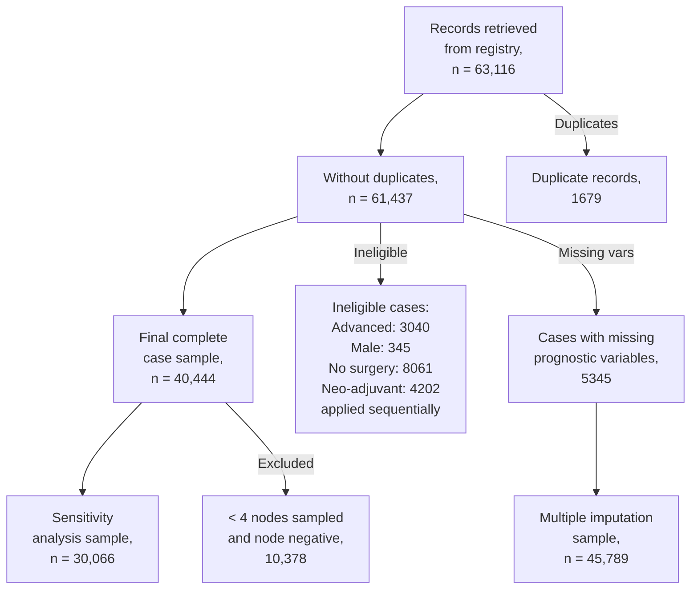

---
aliases:
  - PREDICT
  - Part 4 project
  - ENGSCI 700
tags:
  - engsci700
areas:
  - Statistics
  - Biology
focus area:
  - "[[Breast Cancer]]"
  - "[[Survival Modelling]]"
---

### matthew code flow summary
36 Quarto markdown notebook files

main file flow:
- Data Import, Cleaning and Creation of Set with All Fields
	- combined_dataset.qmd was part of this, I split it out for ease of testing
- lost to followup
- missing data 1
- missing data 2
- logoregional completion
- inclusion/exclusion criteria
- PREDICT Breast variables and formatting
- imputation via MICE
- data prep for GLM
- GLM_involved_nodes
- GLM_ER
- complete case 10 year data
- ER positive and negative models
- stratos ER pos and ER neg
# Meetings
The following are notes taken during meetings with supervisors Hayley Reynolds and Cameron Walker. I didn't take notes for all meetings, but those that do contain notes are included here

## 18-08-2026
- got general c score result of around 0.72?

report feedback:
- revisit table of contents structure - background, scope and objectives, literature review, methods, results

- background section first, then scope and objectives
	- explain what PREDICT is, what the clinical problem is that i'm trying to solve
- move any detail about data to the methods section
- details about breast cancer to the appendix?
	- or move some details about treatment and diagnosis to the literature review
- background and lit review could have figures/diagrams - e.g. what is stage 1-3 vs stage 4? diagram of breast, pictures of ducts and lobules 
	- table with what stage 1-4 are?
- treatments - what the different treatment options are. what are side effects of each treatment? link into treatment threshold 
- methods: data cleaning. add to report methods section about the data preparation? details about how the data selection process works - talk about general process with 1-2 examples. document derived variables and how they were created, then put that into an appendix. 
- methods: ethics alongside the data source. applied for ethical approval within this committee, was approved by


Questions
- differences in diagnosis year by region? 
	- this might be due to midland not collecting ER status q


- plots: survival curve 
- how do i measure the performance of the model? how am I going to compare the performance of the models with one another?
- treatment effect estimates - 
- 'threshold' for survival/death guess estimate
- replicate the dutch dataset 
- c-score by ethnicity
- prostate cancer? is there an existing analysis
- matthew strother presentations has he been working
## 11-08-2026
- [ ] look at age extremes alongside ethnicity to see if there is a correlation in prediction error
- [ ] exploratory data analysis of standard deviation spread of variables like age, region, etc. show 1-2 interesting ones in the main body, show the rest in the appendix
- [ ] improvement of model - refit with ethnicity as a variable?
- [ ] recode the model coefficients?
- [ ] are maori and pacific diagnosed with more severe cancer at younger ages?

## 30-06-2026
currently:
- been fully focused on exams for the past couple weeks, so have made about a week or two worth of progress since we last met
- for individual tables: have successfully got Matthew's R code (with some modifications from me) aligned with my Python results
- also have got combined merged dataset with Python and R code aligned
- the above took a really long time particularly because of the surgery table. this was really difficult to get aligned. i did end up finding some problems with Matthew's code and made appropriate changes. 
	- todo: should do an output comparison of the original code from Matthew vs the modified code, to check that all changes are as expected.
- still in progress with replicating the cohort selection logic in Python. Taking a bit of time as I am also checking Matthew's logic step by step as I go, but nearly there. the surgical completeness logic is quite complex, which is where I'm being held up a bit

next:
- start producing outputs from PREDICT v3 model with the completed dataset
- also working on a summary of the entire dataset & the selected cohort for the following characteristics:
	- will do this overall, by data collection region
- for appendix: summary of data completeness % of all fields used in modelling or cohort selection
- show Matthew a few cases where I got a different output to him, specific patients. 
- completeness of ER status over time
- does the PREDICT github publish a synthetic dataset?
- [[Logistic (Binomial) Regression]] vs [[cox regression]]
- document the checking of my code vs the published PREDICT model 
	- in main body, verify that model got the same answers as the online tool for same input. 
	- can include the particular cases in the appendix
- exclude the mention of the German dataset
- cite Matthew's publication in my report. (2019).

```
general summary:

total number of participants
median followup (years)
number of breast cancer deaths
number of other deaths
annual breast cancer mortality rate
five year breast cancer survival rate
median age at diagnosis, years +- SD
median year of diagnosis, +- SD
  
groups
gender (NA since all female)

menopausal status
pre
post

referral source
screened
symptomatic
  
tumour size
<10
10-19
20-29
30-49
50+


grade
I
II
III

nodes
T1
T2
T3
T4

estrogen receptor status
ER negative
ER positive

progesterone receptor status
PR negative
PR positive

her2 status
positive
negative

ki67 proliferation index >20%
positive
negative
not done
  
adjuvant therapy
chemotherapy
- groups for generations?

  
hormone therapy
biological targeted therapy
- traz, bis?
radiotherapy
- number of grays?
combination


smoking status
current or historical
never smoked
```


## ?
- just try modelling with all missing removed 
	- reflect on the missing data in the reflection
		- is the data missing at random? primarily for more severe / less severe cases? 
		- regional missing data? different demographic data breakdown across areas in the country? 
			- why ER results missing so much in Central region? include explanation
		- with variables that have been dropped - is it a limitation, is it fairly reasonable? 
- how to decide if the amount of missing data is okay? if we have >10,000 data points? 
	- for categoricals, check numbers for each sub-category

## 19-05-2026
progress:
- heard back from Matthew about HER2 calculations
	- he shared justification for using the most positive HER2 result across sources - my understanding based on what he said is: it seems to have slightly better prognostic results to over-treat with trastuzumab rather than under-treat, hence taking the most positive result. 
		- still planning to try out both possible calculation methods and compare model fit
	- BCF manager/clinical contact point has been away and is returning ? next week so will ask about HER2 calculations when she returns
- got combined dataset and cohort selection filtering done with Matthew's code. 
	- surgical completeness rules are feeling more understandable to me now, but still quite complicated. i need to go through the 
- currently looking through some of Matthew's imputation

without ER testing results?
- what is the best model that we can come up with WITHOUT considering these results
- ER completeness records by:
	- time of diagnosis
	- region / diagnosis - Central region much lower

missing values?
- multiple imputation? 
	- fill in missing values with a distribution, do it multiple times
	- more information about uncertainty of missing variables
	- where are the missing values, how are they missing?

## 05-05-2026
progress:
- have been able to access the H drive from my laptop when I try to mount it at university, but for research drive, i see a permission denied error. have been in email contact with support but am planning to head into the library today to ask for some help with figuring out the error. 
- have run Matthew's code for 11/12 input tables

surgery data:
	- surgery data is processed via Matthew's method now. managed to get it working by processing it in chunks
	- found some differences in the result I had vs what his output produces, have been working on getting my code to produce the same output but haven't quite got there yet

 biomarkers:
- table contains HER2 results (main focus), as well as ki67 and oncotypedx results. ki67 and oncotype dx have very low completeness so will not be included in modelling. (there are about 100 ki67 results in over 40k patients)
	- for biomarkers table, I am not sure I should use the same methodology as Matthew. The reason for this is because of how Matthew's code deals with determining overall HER2 status when there are multiple results. His code does not consider where the HER2 results are from (surgical excision biopsy, core biopsy, fine needle aspiration, ? other). 
	- Matthew's code just takes the most positive result from FISH and IHC results. 
	- I think an earlier version of the provided data may not have included this field? the newer version of the data, which I received last year, does include a column ResultsFrom, which I have used to calculate overall HER2 result. 
	- My code calculates HER2 status using the same method which is used by BCFNZ when sending their data to BreastSurgANZ Quality Audit (BQA). When a patient has more than 1 FISH and /or IHC result, the overall FISH or IHC result is chosen as the first available from: 
		- surgical biopsy, core biopsy, FNA 
		- then overall IHC and FISH results are used as inputs to calculate overall HER2 status based on 2018 ASCO/CAP guidelines
		- her2 + if FISH = positive
		- if FISH equivocal, use IHC result:
			- If IHC is 0 or 1+ then the diagnosis is HER2 negative with a comment. • If IHC is 3+ then the diagnosis is HER2 positive


next steps:
- continue checking my code against Matthew's output to make sure differences are fixed or clearly accounted for
- combine individual tables from Matthew's output (plus my biomarkers output) into a single table to begin cohort filtering
- add BQA handbook thing to resources, to show HER2 calculation rules
- what to do about HER2 result calculation? 
	- ask Matthew about HER2 results. why did he take most positive result? did he not have access to the resultsfrom info? 
	- also talk to someone at the breast cancer foundation
	- create two columns - one for each HER2 methodology
- flowchart of how matthew's code works, plus flowchart of how my code works

## 21-04-2026
working on:
- running all of Matthew's R code. A lot of it is very inefficient and takes a very, very long time to run. Was in Christchurch for a fair bit of the break so I have only been able to 
	- got the patient and diagnostic information output from his code
	- includes demographics, lesion measurements and some biomarkers
	- have not been able to successfully run the surgery code Matthew has. I have run it for 1 hour and it did not finish. Have produced what I believe to be equivalent code and have run that and got an output, but today I will be running Matthew's code for longer to try again with getting an output to compare with. 
		- have got an understanding of the logic that he is applying, so if the code doesn't run successfully today I will just move forward with the modified code and try to progress to a full output dataset from Matthew's R code. 
I have Python code which is generating a combined output dataset almost in the required format. Need to deal with some cases with more than 1 lesion. Will borrow Matthew's logic for dealing with tumour size and biomarker status in multi-focal cases

for Matthew's code: choose a subset of a few surgical cases so that it runs faster and I am able to compare

Remote access issue
- check if H drive is accessible from laptop with forticlient VPN running
- ask IT again about access issues - accessible from bioengineering building but not accessible from other buildings in university
- check if R drive is accessible from laptop running on university wifi

Have brief notes about how Matthew's code-base works. Plans to expand this as I work through the code-base and then insert as an appendix to report + reach out to Matthew to check I am doing it right. 
- first, import Excel files and then combine separate tables into one row per patient. Take just the first diagnosis per patient. Surgeries are pivoted into binary columns which specify the side (L/R), surgery number 1-4, and surgery type. This is later used to specify surgical completeness but haven't quite figured out the exact logic 

Should I offer suggestions for code improvement to Matthew? Not sure if that would be rude to bring up but 

## 31-03-2026
done:
got predict 3.0 tool wrapped from R to python. it now runs and produces outputs for individual cases. yet to try it on larger datasets because the transformations are still not quite there. but working for individual cases. 
- next: need to compare individual case outputs with the outputs from the online tool
- then: need to try with larger dataset once validated

used AI to get some more digestible summaries of Matthew's cohort filtering code (still nothing back from him, will follow up when I have something more to show him)
- will add summary of the cohort filtering process to appendix so that I can share it more easily
- his method of determining surgical completeness and loco-regional recurrence completeness was the most confusing to me and I feel like I understand it a bit better now. Patients who received WLE but did not receive radiotherapy are excluded. Did a bit more reading and found that this logic is reflected in some other publications related to the PREDICT breast model so I am happy also using that logic. 
	- There are also a number of other rules that I have less understanding about and would like to discuss his thinking with him - determining surgical completeness based on up to 4 breast and axillary surgeries. Surgery type rules are quite complicated. Have generated an AI summary about some of the rules but I feel I need to go through and check that the generated logic actually matches
	- Have used AI to generate a Python equivalent of some of the cohort selection R code. I haven't been able to test this out yet because I wasn't able to be onsite as much last week. Feels promising though, it is MUCH more readable and far fewer lines of code. 
	- To test the AI generated code, I will run Matthew's code and the generated Python code and compare the outputs with each other. 


action required:
- heard back from tech support about the remote access issue, it seems to be a permissions thing. been advised that either Cam or Hayley should submit a request

literature review:
- will clean up a little before the submission tomorrow, haven't made many changes to it currently

#### action
reach out to matthew with summary of workflow - does this look correct?


## 17-03-2026
convert existing published tool from R to Python
results for NZ data - benchmark performance with other publications - how does it compare?


cohort selection flowchart:


![[Pasted image 20250721161219.png]]
flowchart would be good to include -





Overview of the project:
- validation and ? calibration of the PREDICT breast cancer survival cox regression model, for use in NZ. based on v3 model. will need to consider v4 also though. 
- if time allows, comparison of this calibrated model with alternative approaches involving machine learning - see above. 
- discrimination (c-index of breast cancer specific and overall survival predictions at 10 years)), calibration (predicted survival time vs actual survival time)

Where things got up to:  
Data preparation:

- [ ] cohort filtering - invasive, stage I-III, no metastasis, primary surgery?
- [ ] cohort filtering - age at diagnosis between 25 and 85
- [ ] cohort filtering - require ER status to be known
- [ ] cohort filtering - surgical completeness required - no pending surgeries
- [ ] derived variables
    - [ ] chemo generation
    - [ ] post menopausal yes/no/unknown
    - [ ] ki67 (> 10%)
    - [ ] number of positive nodes
- [ ] exploratory data analysis tables to compare the observed and predicted overall survival by subgroups in cohort
    - [ ] also include breast-cancer specific survival rate

machine learning pipeline:
- part-way through setting up PREDICT model in Python with our data. Got it working in R originally but as R is poorly suited to machine learning, I switched to using Python. The provided codebase is in R. 
- exploratory, basic setup of some machine learning algorithms like survival tree, with German input data though. missing a lot of variables and it was performing poorly
- want to explore using some ensemble models like xgBoost with SHAP for interpretability, boosted cox regression (coxboost)

Written report:
- literature review mostly done. need to add in a new publication that came out in august last year. https://www.medrxiv.org/content/10.1101/2025.08.28.25334663v1.full. England, over 100k patients, new proposed v4 model.
- introduction needs better storytelling. currently a lot of information but poorly organised. should focus more on familiarising the reader with breast cancer, including diagnosis & treatments, info specific to breast cancer in NZ, utility of predictive modelling to help clinicians in recommending treatment options
- methods section needs a lot of work
	- mathematical details about how  about mathematical 

VPN:
- have currently got the VPN working for access to UoA network, but I am not able to connect to the research drive. Have logged a ticket but have not heard back yet

Matthew Strother

## 10-03-2026


Current questions:
- [ ] Have switched to Linux. Not currently able to use VPN to access University files from my computer. Is there an option to get around this? Could we contact the IT support people who we spoke to last year? I recall that they recommended that Linux would be preferable to Windows in general, but we ended up setting up the solution for Windows since it was what I had at the time
- [ ] Am I able to use the work I completed last year as part of my project this year? I know there are often rules about resubmitting existing work and I am not sure how that works in this situation.
- [ ] Currently my report includes mention of the German breast cancer dataset which I was using earlier last year while waiting on ethics approvals. It was helpful at the time but it is missing a lot of variables. A lot of the work for the real NZ dataset doesn't build directly on this. Wondering if I should still mention it in the report? 

Current next steps:
- [ ] get input dataset ready with cohort filtering and derived variable creation
- [ ] run PREDICT 3 model on NZ dataset and calculate c-statistic and Brier score for overall (& breast-cancer specific?) predicted survival time vs actual survival time. Compare to other studies 
- [ ] check in about ethics - do I still have current approval? Do I need to submit a one-year check-in?
	- [ ] expiry 28 may 2028
	- [ ] end of may progress report expected
- [ ] Ask Tom about Linux remote access to university - on 4th floor
	- [ ] Real VNC server, have to put in an IT request
- [ ] get in touch with Matthew Strothers - health issues stopped me last year, am getting back into it
- [ ] re-review literature
- [ ] come in next week with a plan

## 19-08-2025
- [ ] getting the data into python
	- [ ] cohort filtering - invasive, stage I-III, no metastasis, completeness?
	- [ ] cohort filtering - age at diagnosis between 25 and 85
	- [ ] cohort filtering - require ER status to be known
	- [ ] cohort filtering - 
- [ ] derived variables
	- [ ] chemo generation 
	- [ ] post menopausal yes/no/unknown
	- [ ] ki67 (> 10%)
	- [ ] number of positive nodes
- [ ] exploratory data analysis tables to compare the observed and predicted overall survival 

## 19-06-2025
### Hayley
- [ ] once all parties have signed MOU by everyone:
	- [ ] data can be sent once the MOU is done - Cathy approved
	- [ ] data refresh has been approved by Alison - analyst will do, send to Jaya for checks. once confirms that all looks good, set to me and set to Matthew separately. 
	- [ ] will need to check when Sue is back, w.r.t. ethics requirements? sue back 3rd july

matthew main supervisor katrina has also said they are quite distinct projects - we could put something in writing - deadlines for mid year technical report, try to copy cam and hayley into communications with cathy 

- Matthew ethics amendment hear back when?
	- where is that process at? 
	- has it been submitted already? 
	- Matthew said he can today, no time finalised yet 
### cathy
**sue:** says she does not even need to sign? her name does not need to be on it, none of BCFNR need to sign it?


- [ ] chase up matthew, try to meet 
	- [ ] progress on ethics amendment? was under the impression this was not going to be required
	- [ ] code review
		- [ ] hormone receptor status from core biopsy as well as from histopathology? would improve numbers a fair bit
		- [ ] what is the flow for surgical completeness to be determined?
	- [ ] could he organise the meeting with 

- [x] sign MOU from hayley ✅ 2025-06-19
- [ ] send signed MOU to Cam, with an update on progress. Also to Hayley copy in
- [ ] chase up everyone else about the signatures
	- [ ] Matthew (and Schofield)
	- [ ] Cathy (?)
**Copy everyone in to all emails**

Hayley 
- Chicago
- lymphatic system conference
- 3 days
- gave a talk at the end of the day


## 29-05-2025
approve from ethics
it request to add to research drive
- cam to email to add to melanoma research

- [ ] data cleaning - branch and comment 
- [ ] results - will need balanced discussion of why i did things, limitations of data source, 
- [ ] drop ambiguity in sentences - precision is important
- [ ] describe breast cancer in opening
- [ ] can put one example of similar plots done across 
- [ ] compare own results to those in the german breast cancer study

should be possible to read the whole report WITHOUT the figures and still make sense
should also be able to look at caption and understand figure, vice versa

10+ lymph nodes removed higher survival rate 
- weird result
- maybe different dissection method? axillary node dissection - no info about that in german dataset

what to include in report ? 
- plots that are RELEVANT to the overall research question
	- can say in short, we tested differences across ___ group and found none. non significant p value for example. 
		- can put p values in appendix somewhere

age at diagnosis by histological grade & ... 
- not that useful, no notable pattern

hayley away 10-17 june
cam away until july 21
- contactable via email
- can send him parts of report directly in email and he'll get back 
- data cleaning first

### exploratory data analysis 
tried and did not use:
- tumour size vs positive nodes by menopause status, not useful
- year of diagnosis does not seem to have much impact on tumour characteristics, but does relate to survival probability  (?)

## Meeting 14-05-2025
[[2025-05-14]]

report structure - focus on STORY not just dumping info

[[Grid search]]
[[k-fold cross validation]]
### to do 
- [ ] data descriptions for the variables in the german and register datasets
- [ ] exploratory data analysis for both, [[Trellis plot]] is a good idea to use
- [ ] flowchart for exclusions in the dataset
- [ ] plots for treatment
### Progress
- report work: 
	- added a table description of bcf data and the german data
	- added a description of the predict model
	- added a description of german dataset and what i have done with it so far
	- in progress: adding a summary of how the PREDICT algo performs on the datasets - actual survival rate vs predicted. 

## Meeting 01-05-2025
[[2025-05-01]]

gridsearch, hyperparameter tuning?
k-fold cross validation
- equivalent folds in terms of key
chapter on machine learning pipeline?
- run experiments where train on nz data, compare
report is **telling a story**, ongoing, develop ML pipeline this way.
- add german data to data sources in methods in report
### Questions
- Heard back from sue yet? Should I follow up and ask her about MOU?
	- nothing back from Sue
	- can I get the data directly from BCF?
### Not yet done 
- [ ] Add description of PREDICT model to the report, 1-2 pages of content
- [ ] Fractional polynomials?
- [ ] Add staging description to report
### Progress
- Implemented rough versions of
	- a cox model based on test data
	- xgboosted cox model 
	- a random forest
- bootstrapping, calculating c-index and brier score for above models (excluding the random forest, which seems ineffective) 
- xgboost is doing poorly in comparison to the other options
- found deepsurv, which fits a neural network based on a cox ph, plan to implement to compare to xgboost as an option